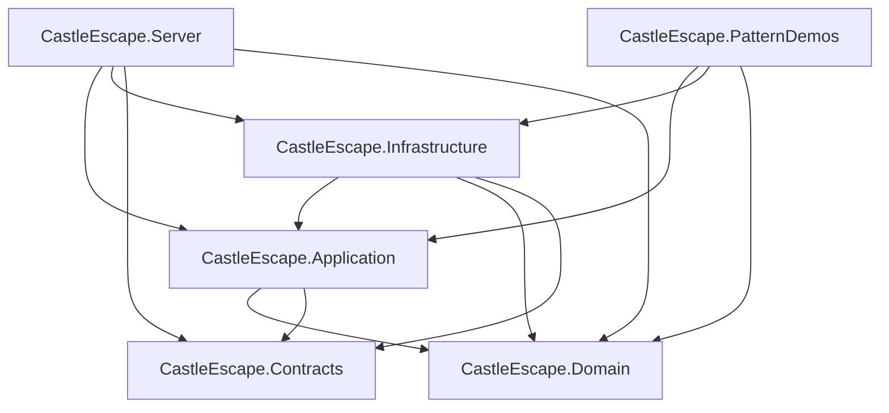
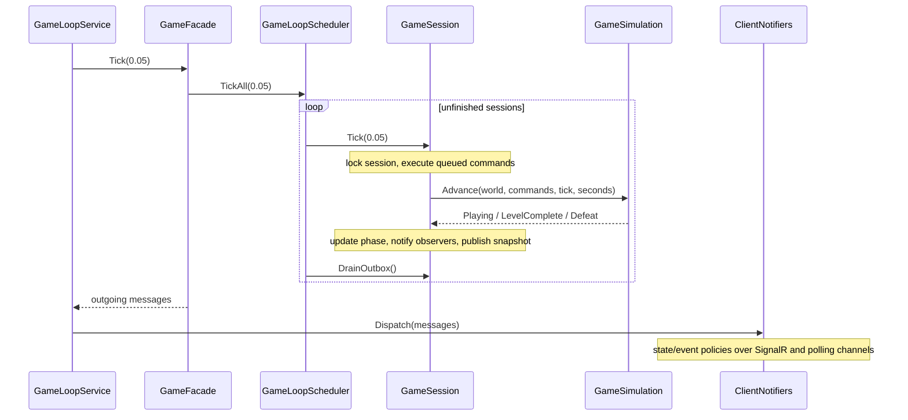

# Backend architecture

The backend is divided into Domain, Application, Infrastructure, Contracts and Server projects. The console course demonstrations live under `tools` and are not referenced by any runtime project. All runtime projects execute in one backend process.

## Project dependencies

Arrows mean project references:

Domain and Contracts have no references to other solution projects. Application uses the independent Contracts assembly for its public results and notification messages. This is a deliberate shared-DTO boundary: it avoids duplicating every snapshot in both application and transport models. Domain remains independent of all wire types; `SnapshotMapper` and `ContentQueries` convert domain state and enums explicitly. Infrastructure implements application/domain interfaces. Server selects the implementations in its composition root.

## Where code belongs

| Project | Responsibility | Main entry points |
|---|---|---|
| Domain | Entities, rules, deterministic simulation, builders, item/theme factories, powers and events | `Sessions/GameSimulation`, `GameWorld`, `World/`, `Generation/`, `Content/ContentValidator` |
| Application | Lobby and session use cases, phase progression, command execution, observers, DTO snapshots and notification policy | `Sessions/GameFacade`, `GameSession`, `SessionRegistry`, `Snapshots/SnapshotMapper`, `Content/ContentQueries` |
| Infrastructure | JSON files, preset map files, serializer adapters, in-memory session store and polling buffer | `Content/ContentCatalog`, `ContentLoader`, `FilePresetMapSource`, `Sessions/InMemorySessionStore`, `Serialization/`, `Messaging/` |
| Contracts | Public request/response DTOs, SignalR messages and wire enums | `Sessions/`, `Gameplay/`, `Realtime/`, `Content/` |
| Server | HTTP/SignalR entry points, hosted timer, SignalR channel and dependency registration | `Program.cs`, `Configuration/ServiceRegistration`, `Endpoints/`, `Hubs/`, `Realtime/` |
| PatternDemos | Course scenarios, reflection catalog, demo results and console runner | `tools/CastleEscape.PatternDemos/Program.cs`, `Demos/`, `Catalog/` |

`PlayerState` is the domain participant. Application's `PlayerSlot` adds a player token and connection metadata. `GameWorld` sees only domain participants. `GameSimulation.Advance` contains movement, powers, enemies, interactions and exit rules. `GameSession` coordinates the simulation, phases and published results.

`IContentCatalog`, `IPresetMapSource` and `ISessionStore` are the boundaries for content and storage. Builders receive definitions and preset rows; they do not read files. The infrastructure `ContentCatalog.Instance` remains the thread-safe Singleton required by the course, supplied through `IContentCatalog` by the host.

## A tick and its messages

The configured rate is 20 ticks per second. Requests enqueue commands into a concurrent queue; commands in each drained batch execute in assigned sequence order. Movement uses tile steps with continuous progress. Two conflicting player steps use Command undo to cancel the later claimant.

One lock protects each session. Development undo and skip-level operations also acquire that lock. Snapshot reads do not lock: the latest snapshot reference is published after updates and treated as read-only. DTO arrays and dictionaries are not deeply immutable. Token lookup, event-log reads and command-history reads still take the lock.

## API and course boundaries

Normal clients use `/api/content`, `/api/sessions` and `/hubs/game`. REST state and polling support JSON/XML through the adapters. SignalR uses its configured JSON protocol. `StateNotifier` and `EventNotifier` form the Bridge over SignalR and polling delivery implementations.

There are no `/api/patterns` endpoints and no runtime clone-mode endpoint. The normal host does not bind `Patterns:PrototypeCloneMode`; sessions use Deep. The console Prototype demonstration accepts `--mode Deep`, `--mode Shallow` or `--mode both`. The game patterns themselves remain in their feature code, with lightweight metadata attributes for course discovery.

Development shortcuts and the browser playground remain gated by `DevTools:Enabled`. They support playing and testing the actual game: quickstart, undo, power grants, strategy switching and level skipping. Content responses are explicit DTOs. Existing obstacle `variant` and preview fields remain for client compatibility; new clients should use stable content IDs rather than concrete class names.

## Storage and limitations

Sessions and buffered messages remain in memory. Restarting the process loses sessions; session expiry, persistence and multi-server routing are not implemented. The structural refactoring does not change these semantics. Restart-command undo still does not restore active powers; the prototype address demonstration's no-GC fallback remains a known course-evidence limitation from the historical audit.

## Verification and future work

`CastleEscape.Core.Tests` covers Domain, Application, Infrastructure and the twelve course demos. `CastleEscape.Server.Tests` covers HTTP, SignalR, OpenAPI and host dependencies. Architecture tests enforce Domain/Contracts independence, Application's allowed references, matching boundary enum values and the absence of runtime references to demo tooling.

See [CODE_WALKTHROUGH](CODE_WALKTHROUGH.md) for Visual Studio navigation and [P2_ROADMAP](P2_ROADMAP.md) for the remaining course patterns.
