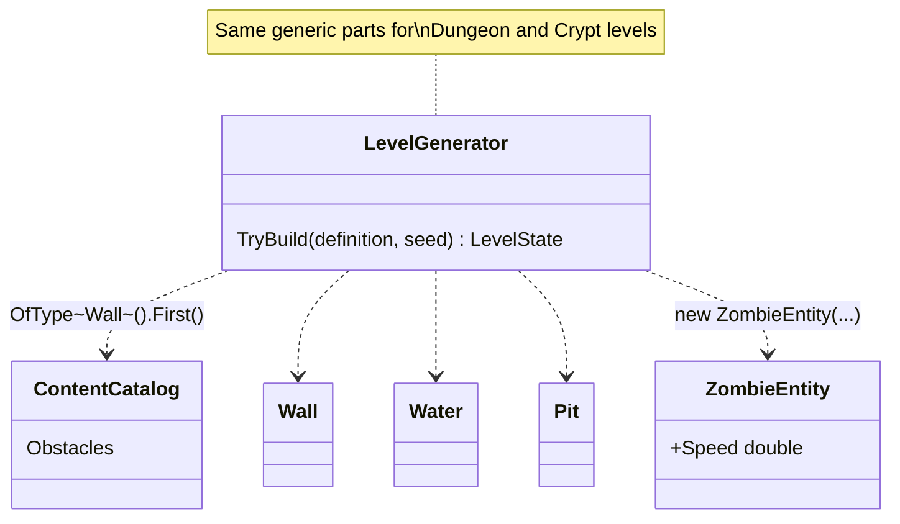
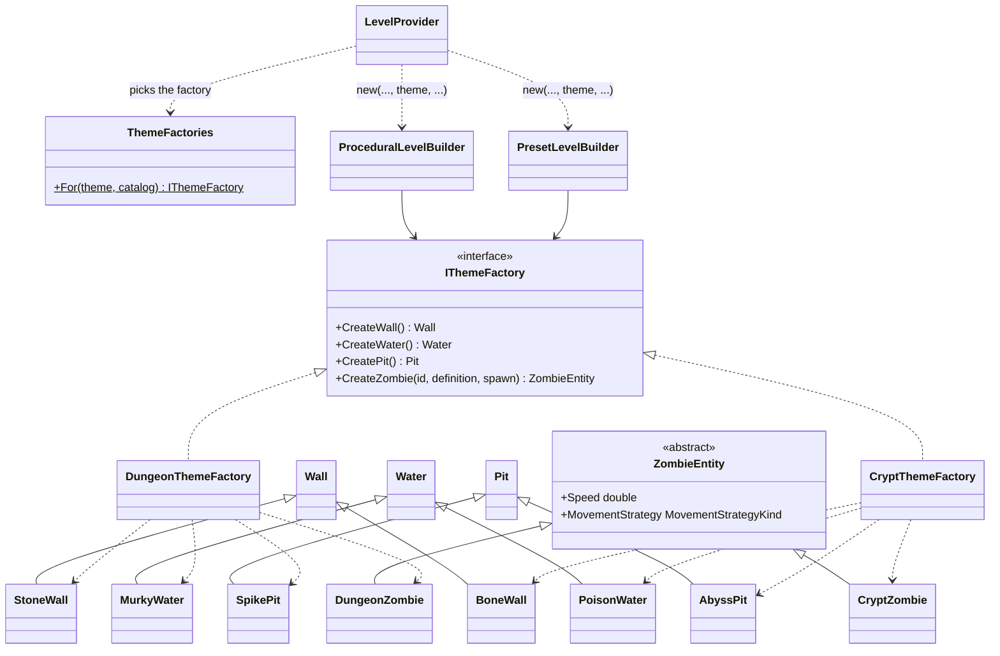

# Abstract Factory — level themes

**Owner:** Student A · **Category:** Creational · **Code:** `src/CastleEscape.Game/Generation/Themes/`
**Demo:** `dotnet run --project src/CastleEscape.PatternDemos -- abstract-factory` (plain console code: `src/CastleEscape.PatternDemos/AbstractFactoryDemo.cs`)
**Used by:** `LevelProvider` picks the factory, the two level builders use it; `GET /api/sessions/{id}/level` lists the variants used (`obstacles`).

## Problem in this game

Levels 1–5 are Dungeon and 6–10 are Crypt (`content/levels.json`). A theme is more than a colour:
its walls, water, pits and zombies belong together, and the Crypt ones are harder (slower water and
pits, faster zombies that find paths). Without the pattern, every place that creates a part would
need its own theme check (`if (theme == Crypt) new PoisonWater() else …`), and one missed check
puts a Dungeon pit into a Crypt level.

## Why Abstract Factory

We need a *family* of related products (wall, water, pit, zombie) that must be used together,
and several families (themes). An abstract factory is one object that creates every product of one
family. The level builder asks for "a wall" or "a zombie", and the factory it was given decides
which family. The factory is picked once per level, so mixing families is impossible by
construction. Adding a theme means adding one factory and its products; the builders don't change.

The implementation is plain C#: an interface, two classes that implement it, and one `switch`
that picks between them. No framework, attributes or reflection.

## Participants

| Role | Class |
|---|---|
| AbstractFactory | `IThemeFactory` (`CreateWall`, `CreateWater`, `CreatePit`, `CreateZombie`) |
| ConcreteFactory | `DungeonThemeFactory`, `CryptThemeFactory` |
| AbstractProduct | `Wall`, `Water`, `Pit` (content classes), `ZombieEntity` (abstract) |
| ConcreteProduct | Dungeon: `StoneWall`, `MurkyWater`, `SpikePit`, `DungeonZombie` · Crypt: `BoneWall`, `PoisonWater`, `AbyssPit`, `CryptZombie` |
| Client | `ProceduralLevelBuilder`, `PresetLevelBuilder` (they use the factory); `LevelProvider` (it picks the factory with `ThemeFactories.For`) |

| Product | Dungeon | Crypt |
|---|---|---|
| Wall | `StoneWall` | `BoneWall` |
| Water (speed ×) | `MurkyWater` 0.6 | `PoisonWater` 0.45 |
| Pit (speed ×) | `SpikePit` 1.0 | `AbyssPit` 0.8 |
| Zombie | `DungeonZombie`: type speed, type strategy | `CryptZombie`: speed ×1.2, Greedy upgraded to BFS |

The factories get the generic wall, water and pit from `content/obstacles.json` in their
constructor, and each themed product starts from those values (copy constructor). So rules such as
"water needs Swim" and patch sizes stay in the content file (C7).

## Before (tag `p1-prototype-before-patterns`)



## After



## Key code

```csharp
// LevelProvider.Generate: pick the family once, give it to the builder
IThemeFactory theme = ThemeFactories.For(definition.Theme, catalog);
var builder = new ProceduralLevelBuilder(catalog, definition, theme, attemptSeed, game, generation);

// ThemeFactories.For: the only place that maps a theme to a factory
return theme switch
{
    LevelTheme.Dungeon => new DungeonThemeFactory(wall, water, pit),
    LevelTheme.Crypt => new CryptThemeFactory(wall, water, pit),
    _ => throw new ArgumentOutOfRangeException(nameof(theme), theme, "No factory for this theme."),
};

// ProceduralLevelBuilder: only knows IThemeFactory and the abstract products
_wall = theme.CreateWall();
obstacle = _theme.CreateWater();
_level.AddZombie(_theme.CreateZombie(_level.NextEntityId("zombie"), type, spot));
```

```csharp
public sealed class CryptThemeFactory(Wall wallTemplate, Water waterTemplate, Pit pitTemplate) : IThemeFactory
{
    public Wall CreateWall() => new BoneWall(wallTemplate);
    public Water CreateWater() => new PoisonWater(waterTemplate);
    public Pit CreatePit() => new AbyssPit(pitTemplate);
    public ZombieEntity CreateZombie(string id, ZombieDefinition definition, GridPos spawn) => new CryptZombie(id, definition, spawn);
}
```

## Requirement: "at least 2 concrete factories, at least 3 classes per family"

2 factories × 4 products. `AbstractFactoryTests.TwoConcreteFactories_WithFourProductsEach` lists
both families and checks that no class is in both. `GeneratedLevels_NeverMixFamilies` generates all
10 levels with 5 seeds each and checks that every obstacle and zombie comes from that level's
factory. The console demo prints both families with their values, then the parts actually used in
a Dungeon and a Crypt level.

## Likely live-change requests

| Request | Where to edit |
|---|---|
| "Add a third theme (e.g. Tower)" | `LevelTheme.Tower`; `TowerThemeFactory` and its four products; one case in `ThemeFactories.For`; set `theme` in `content/levels.json`. The builders don't change. |
| "Add a product to every family (e.g. a lava tile)" | New method on `IThemeFactory` and implementations in both factories. This is the pattern's known cost: the compiler lists every factory to update. |
| "Crypt water even slower" | `PoisonWater.SpeedMultiplier`. |
| "Crypt zombies should be A*" | `CryptZombie.MovementStrategy`. |
| "Difference from Factory Method?" | See [FactoryMethod.md](FactoryMethod.md): Factory Method is one method subclasses override to make one product; Abstract Factory is an object that makes a family of related products. |
| "Difference from Builder?" | The factory decides *which* parts (themed classes); the Builder ([Builder.md](Builder.md)) decides *how and where* they go, step by step. |
