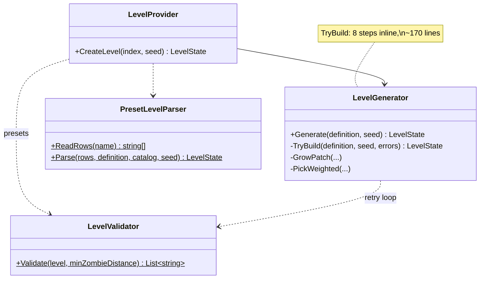
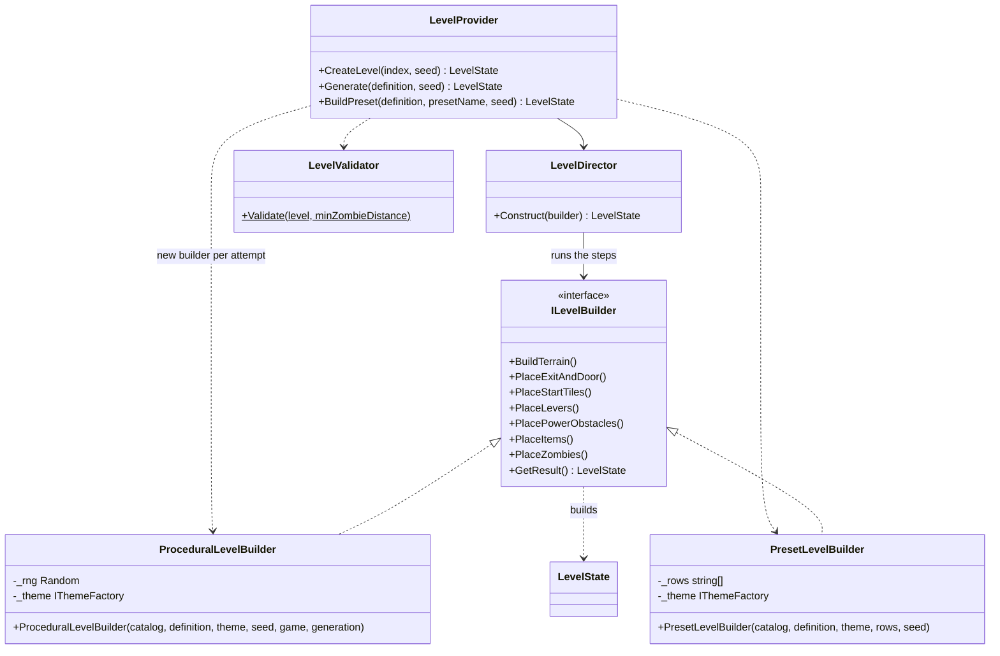

# Builder — level construction

**Owner:** Student A · **Category:** Creational · **Code:** `src/CastleEscape.Game/Generation/` (`ILevelBuilder`, `LevelDirector`, `ProceduralLevelBuilder`, `PresetLevelBuilder`)
**Demo:** `dotnet run --project src/CastleEscape.PatternDemos -- builder` (plain console code: `src/CastleEscape.PatternDemos/BuilderDemo.cs`)
**Used by:** `LevelProvider` (every level a session plays), `RowsLevelProvider` (test and demo maps), `LevelPreviewer` (`GET /api/levels/{index}/preview`).

## Problem in this game

A level is built in many ordered steps with constraints between them. The door must exist before
the start tiles can be checked for a path to it; the levers before the power obstacles, which must
not cut the critical path (D5); items before zombies, which must not share tiles. There are also two
very different ways to make a level: random generation, and hand-made ASCII maps for tests, demos
and the tutorial.

In the prototype this was a 250-line `LevelGenerator.TryBuild` doing all steps inline, plus a
separate `PresetLevelParser` that repeated the object placement in a character switch.

## Why Builder

Builder separates *the order of the construction steps* (the director) from *how each step is
done* (the concrete builders). Both level sources run through the same director. Each step is a
small method with one job, and a third source (e.g. a level loaded from a database) is one more
builder. The result (`LevelState`) is handed out by `GetResult()` once all steps have run.

The implementation is plain C#: an interface, two classes that implement it, and a director class
whose only method calls the steps in order. No framework, attributes or reflection.

## Participants

| Role | Class |
|---|---|
| Builder | `ILevelBuilder` (7 steps + `GetResult`) |
| ConcreteBuilder | `ProceduralLevelBuilder` (seeded random), `PresetLevelBuilder` (ASCII map) |
| Director | `LevelDirector` (`Construct(builder)`: the step order, nothing else) |
| Product | `LevelState` |
| Client | `LevelProvider`: creates the builder, asks the director to build, then validates the level and retries with a new seed if it is not valid |

A builder is created for one level and gets everything it needs in its constructor: the level
definition, the theme factory ([Abstract Factory](AbstractFactory.md)) and the seed or the map rows.
The item steps use the item spawners ([Factory Method](FactoryMethod.md)). The creational patterns
work together: the factories make the parts and the builder puts them in place.

## Before (tag `p1-prototype-before-patterns`)



## After



## Key code

```csharp
public sealed class LevelDirector
{
    public LevelState Construct(ILevelBuilder builder)
    {
        builder.BuildTerrain();
        builder.PlaceExitAndDoor();
        builder.PlaceStartTiles();
        builder.PlaceLevers();
        builder.PlacePowerObstacles();
        builder.PlaceItems();
        builder.PlaceZombies();
        return builder.GetResult();
    }
}
```

```csharp
public LevelState Generate(LevelDefinition definition, int seed)   // LevelProvider, the client
{
    IThemeFactory theme = ThemeFactories.For(definition.Theme, catalog);
    List<string> errors = [];
    for (var attempt = 0; attempt < generation.MaxAttempts; attempt++)
    {
        var attemptSeed = unchecked(seed + attempt * 7919);
        var builder = new ProceduralLevelBuilder(catalog, definition, theme, attemptSeed, game, generation);
        try
        {
            var level = _director.Construct(builder);
            errors = LevelValidator.Validate(level, generation.MinZombieDistanceFromStart);
            if (errors.Count == 0)
            {
                return level;
            }
        }
        catch (LevelBuildException ex) // a step found no room; try another seed
        {
            errors = [ex.Message];
        }
    }
    throw new LevelGenerationException(definition.Index, errors);
}
```

## Requirement: "at least 2 concrete builders"

`ProceduralLevelBuilder` and `PresetLevelBuilder` implement every step differently. For example,
`PlaceLevers` picks two random reachable tiles at least 6 apart in one, and reads the `L`
characters in the other. `BuilderTests` checks:
- the director calls the steps in order (with a recording builder);
- the same director builds valid levels of the right theme with both builders;
- the provider retries with new seeds until a level is valid, and gives up after `MaxAttempts`;
- the preset from `Generation:PresetLevel` is played, and an unknown preset is reported.

The console demo builds level 1 with both builders through one director and prints both maps.

## Likely live-change requests

| Request | Where to edit |
|---|---|
| "Add a third builder (e.g. a maze, or levels from a database)" | A new class implementing `ILevelBuilder`; create it in `LevelProvider`. The director doesn't change. |
| "Place levers before the exit" / "add a step (e.g. traps)" | `LevelDirector.Construct` (the order) and a new method on `ILevelBuilder` with an implementation in each builder. |
| "Three levers instead of two" | `ProceduralLevelBuilder.PlaceLevers` (`_levers.Count < 2`); presets just add another `L`. The door logic already handles any number. |
| "More retries" | `Generation:MaxAttempts` in appsettings. |
| "Play a preset instead of random levels" | `Generation:PresetLevel = tutorial` (or `arena`). |
| "Difference from Abstract Factory?" | The factory decides *which* parts (themed classes); the builder decides *how and where* they are put together, step by step, and returns the finished level once. |
