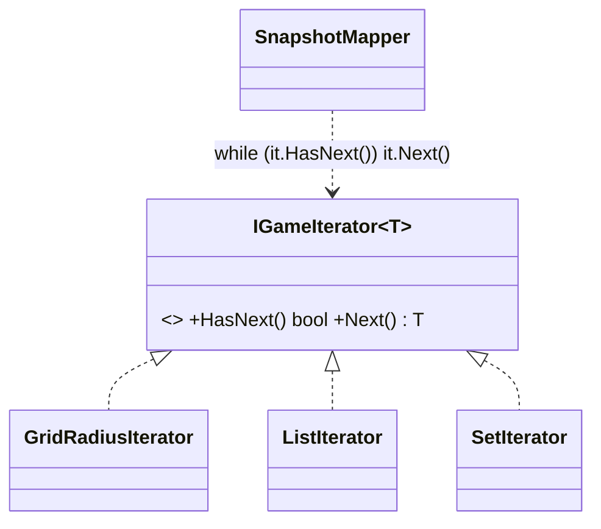

# Iterator

**Requirement:** iterate over ≥3 different data structures through one interface.

## Problem
Fog of war: clients should only get what lies within `Game:ViewRadius` tiles of a player.
Building that message means walking three different structures: the grid's 2D tile array,
the level's entity lists, and the set of visible tiles.

## Solution
One interface, [`IGameIterator<T>`](../../src/CastleEscape.Game/World/Iterators.cs) (`HasNext()` / `Next()`),
with one iterator per structure:

| Iterator | Structure | Used for |
|---|---|---|
| `GridRadiusIterator` | `Grid` (2D array) | cells within the radius of one player (circle, clipped to the grid) |
| `ListIterator<T>` | `List<T>` | zombies, items and levers; only those on a visible tile are sent |
| `SetIterator<T>` | `HashSet<GridPos>` | the visible tiles (union of both players); writes them into the fogged rows |

The client code walks every structure the same way, without knowing whether it's indexed by (x, y),
by position in a list, or not indexed at all (a hash set).

All of it lives in [`SnapshotMapper.ToTickState`](../../src/CastleEscape.Game/Sessions/SnapshotMapper.cs).
`TickStateMessage.VisibleRows` carries the terrain with `' '` for unseen tiles. `LevelStarted.Rows` is fogged too.

## Defence switch
`Game:ViewRadius` in appsettings: `5` by default, `0` = whole map (the previous behaviour).
Likely live changes: a square instead of a circle (drop the `dx²+dy²` check), a bigger radius,
or remembering explored tiles.
