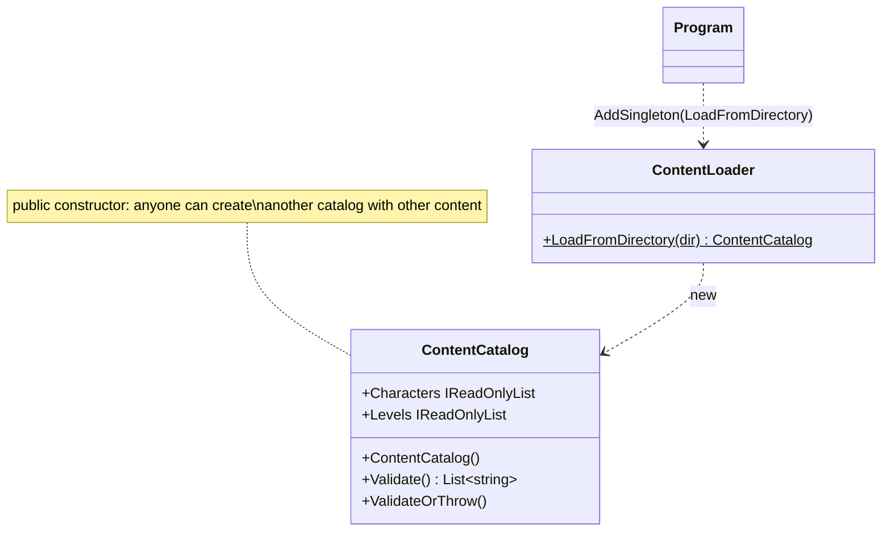
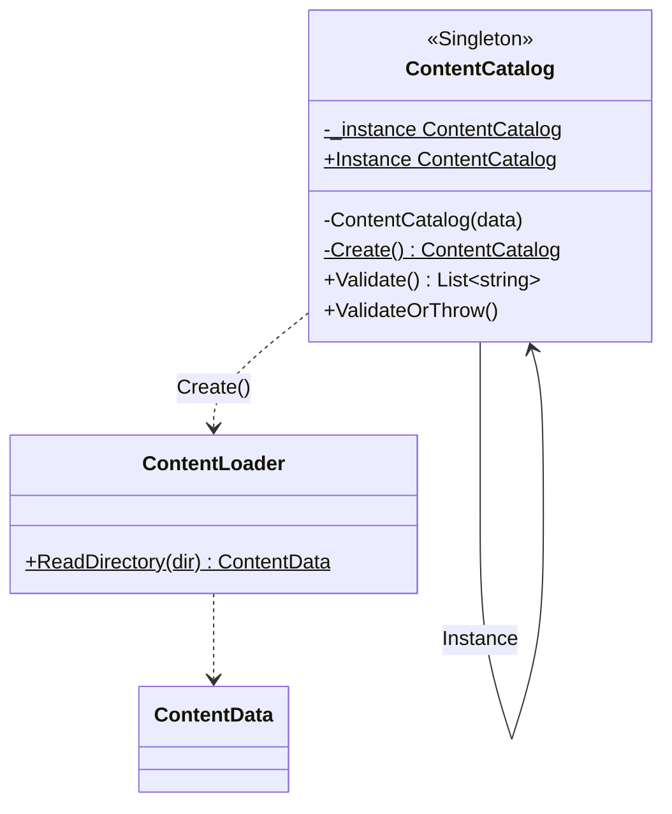

# Singleton — `ContentCatalog`

**Owner:** Student C · **Category:** Creational · **Code:** `src/CastleEscape.Game/Content/ContentCatalog.cs`
**Demo:** `dotnet run --project src/CastleEscape.PatternDemos -- singleton` · `POST /api/patterns/singleton/demo`

## Problem in this game

All game content (characters, items, combos, obstacles, zombie types, 10 levels) is read from
`content/*.json`. Every session, the level generator, the zombie AI and the Content endpoints
need it. It must be:
- loaded and validated **once**;
- **the same object everywhere**, so content can't differ between sessions or endpoints.

## Why Singleton

The catalog is one read-only thing for the whole process, and the class itself should guarantee
that. Nobody should be able to make a second catalog by accident, with a different or
unvalidated content set.

**No framework, no DI.** The pattern is hand-written: a private static field, a private
constructor, and a static `Instance` property. It doesn't use `Lazy<T>` or `lock`, and it isn't
registered in the DI container. `Program.cs`, the endpoints, the console demo and the unit tests
all read `ContentCatalog.Instance` directly.

## Participants

| Role | Class | Notes |
|---|---|---|
| Singleton | `ContentCatalog` | private constructor, private static `_instance`, `static Instance => _instance ??= Create()` |

## Before (tag `p1-prototype-before-patterns`)



## After



## Key code

```csharp
private static ContentCatalog? _instance;

public static ContentCatalog Instance => _instance ??= Create();

private ContentCatalog(ContentData data) { ... }   // nobody else can construct one
```

The first read of `Instance` loads and validates the content and stores it. Every later read
returns the stored object.

## Thread safety

This version is deliberately **not** thread-safe. If two threads read `Instance` for the very first
time together, both can see `null` and both build a catalog. The server avoids that by reading it
once in `Program.cs` (`_ = ContentCatalog.Instance;`). That read runs on the main thread before
`app.Run()`, so the catalog already exists before any request, hub or game-loop thread starts.

`SingletonDemo` shows that every read returns the same object (`sameInstance: true`) and that
`ContentCatalog` has no public constructor (`publicConstructors: 0`).
Tests: `tests/CastleEscape.Game.Tests/Patterns/SingletonTests.cs`.

## Likely live-change requests

| Request | Where to edit |
|---|---|
| "Make it thread-safe" | Add `private static readonly object Gate = new();` and use `get { lock (Gate) { return _instance ??= Create(); } }`. Only one thread at a time can check and create. |
| "Make it eager instead of lazy" | Replace the field and property with `public static ContentCatalog Instance { get; } = Create();`. The catalog is created when the class is first used, and the CLR runs that initializer once. |
| "Add a new content type" | Add a list to `ContentData`, `ContentCatalog` (property + constructor), `ContentLoader.ReadDirectory`, plus a JSON file. |
